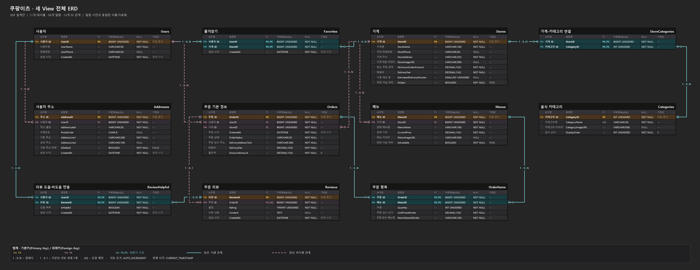
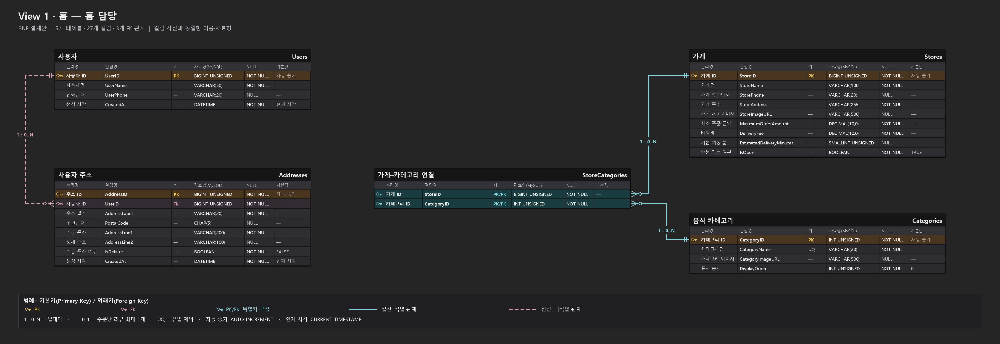
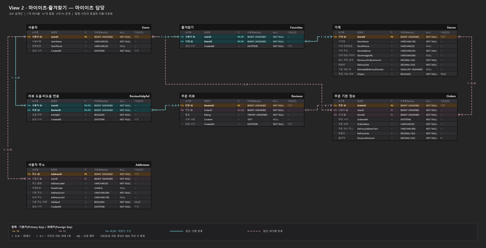
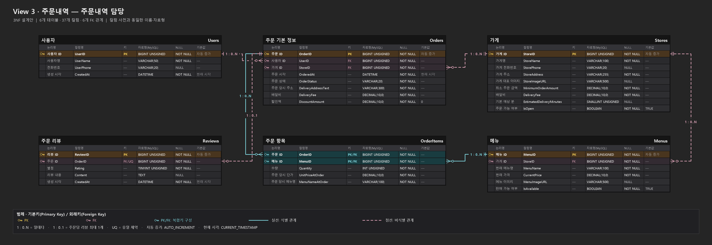

# ERD

홈·마이이츠·주문내역의 ERD. 11개 테이블, 58개 컬럼, 13개 외래키 관계로 구성한다.

[컬럼 사전](../db-column-dictionary.md) · [1NF → 2NF → 3NF 과정](../normalization.md)

이 구조를 schema.sql로 구현하고 MySQL에서 검증했다. 테이블 변경 시 API 담당자와 협의하고 컬럼 사전·ERD·DDL을 함께 수정한다.

## 전체 ERD

[PNG 원본](db8-erd-full.png) · [SVG 원본](db8-erd-full.svg)



## 화면별 ERD

전체 ERD에서 화면별로 사용하는 테이블을 발췌했다.

### 홈

[PNG 원본](db8-erd-home.png) · [SVG 원본](db8-erd-home.svg)



### 마이이츠·즐겨찾기

[PNG 원본](db8-erd-my-page.png) · [SVG 원본](db8-erd-my-page.svg)



### 주문내역

[PNG 원본](db8-erd-orders.png) · [SVG 원본](db8-erd-orders.svg)



## 읽는 방법

- 노란색 PK: 기본키(Primary Key). 청록색 PK/FK: 기본키 구성 컬럼이면서 외래키(Foreign Key).
- 분홍색 FK: 외래키. UQ: 유일 제약(UNIQUE).
- 청록색 실선: 부모 키가 자식 기본키에 포함되는 식별 관계(Identifying Relationship). 분홍색 점선: 비식별 관계(Non-identifying Relationship).
- `1 : 0..N`: 자식은 부모 한 개를 참조하고 부모에는 자식이 없거나 여러 개일 수 있다. 주문 항목 최소 1개 등의 업무 규칙은 별도로 검증한다.
- `Orders 1 : 0..1 Reviews`: `Reviews.OrderID`의 UNIQUE로 주문당 리뷰를 최대 1개로 제한한다.
- 선이 교차하는 곳은 연결점이 아니다.
- 단일 ID 기본키는 AUTO_INCREMENT다. 그림의 '현재 시각'은 DEFAULT CURRENT_TIMESTAMP를 뜻한다.

다대다(M:N) 관계는 `Favorites`, `StoreCategories`, `OrderItems`, `ReviewHelpful` 연결 테이블로 나눴다.

`ReviewHelpful.IsHelpful`은 TRUE=도움이 돼요, FALSE=도움이 안 돼요다. 같은 사용자·리뷰의 반응은 한 행으로 저장하고 반응 취소 시 삭제한다.

## 다시 생성하기

Windows, Python, Pillow가 필요하다. 저장소 루트에서 실행한다.

```powershell
python docs/erd/generate_erd.py
```

컬럼 사전에서 PNG·SVG를 생성하고 테이블·컬럼·FK 수와 그림 배치를 확인한다.
