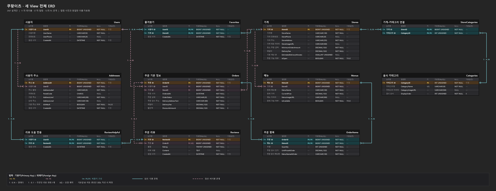
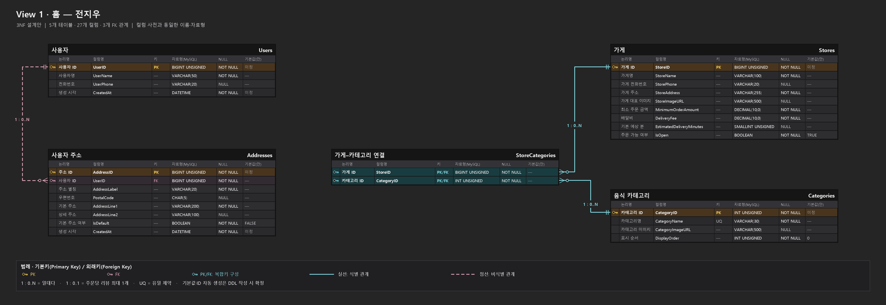
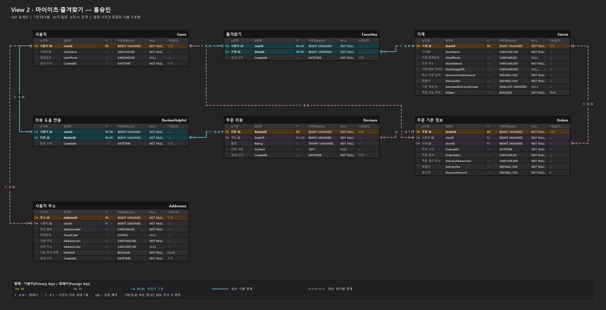
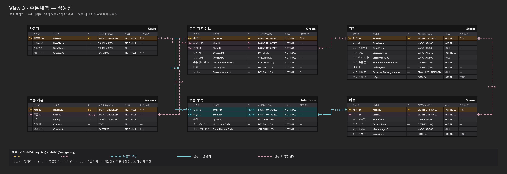

# ERD

세 View를 위한 **11개 테이블·57개 컬럼·13개 외래키 관계**를 표현한 ERD 설계안입니다. [컬럼 사전](../db-column-dictionary.md)의 이름·자료형·키·NULL 여부를 그대로 사용합니다. 정규화 근거는 [1NF → 2NF → 3NF 과정](../normalization.md)을 참고하세요.

아래 그림은 설계 문서이며 실제 MySQL에서 생성한 결과가 아닙니다. `db/schema.sql` 작성과 MySQL 실행 검증은 다음 단계입니다. 테이블 변경은 API 담당자와 합의하고 컬럼 사전·ERD·DDL을 함께 갱신합니다.

## 전체 ERD

[PNG 원본](db8-erd-full.png) · [수정 가능한 SVG](db8-erd-full.svg)



## View별 확대 그림

해당 View에서 사용하는 테이블과 그 테이블 사이의 관계만 표시합니다. 전체 설계에 없는 독립 DB를 추가한 것이 아닙니다.

### View 1: 홈 — 전지우

[PNG 원본](db8-erd-home.png) · [SVG 원본](db8-erd-home.svg)



### View 2: 마이이츠·즐겨찾기 — 홍승민

[PNG 원본](db8-erd-my-page.png) · [SVG 원본](db8-erd-my-page.svg)



### View 3: 주문내역 — 심동진

[PNG 원본](db8-erd-orders.png) · [SVG 원본](db8-erd-orders.svg)



## 읽는 방법

- 노란색 PK: 기본키(Primary Key). 청록색 PK/FK: 기본키 구성 컬럼이면서 외래키(Foreign Key).
- 분홍색 FK: 외래키. UQ: 유일 제약(UNIQUE).
- 청록색 실선: 부모 키가 자식 기본키에 포함되는 식별 관계(Identifying Relationship). 분홍색 점선: 비식별 관계(Non-identifying Relationship).
- `1 : 0..N`: 자식은 부모 한 개를 참조하며 부모에는 자식이 없거나 여러 개일 수 있습니다. 주문 항목 최소 1개 등 추가 업무 규칙은 별도로 검증합니다.
- `Orders 1 : 0..1 Reviews`: 주문당 리뷰 최대 1개이며 `Reviews.OrderID`의 UNIQUE로 제한합니다.
- 선의 교차는 관계의 합류를 뜻하지 않습니다. 각 선이 닿는 컬럼을 기준으로 읽습니다.
- 기본값은 설계안에 명시된 값만 표시합니다. ID 자동 생성 방식은 아직 미정입니다.

사용자–가게는 `Favorites`, 가게–카테고리는 `StoreCategories`, 주문–메뉴는 `OrderItems`, 사용자–리뷰 도움 반응은 `ReviewHelpful`를 통해 M:N을 두 개의 1:N 관계로 분해합니다.

## 다시 생성하기

Windows에서 Python과 Pillow를 사용합니다. 저장소 루트에서 실행합니다.

```powershell
python docs/erd/generate_erd.py
```

생성기는 컬럼 사전을 읽어 전체 11개 테이블·57개 컬럼·13개 FK와 자료형·텍스트 크기·관계선 겹침을 확인하고 PNG와 SVG를 함께 생성합니다.
